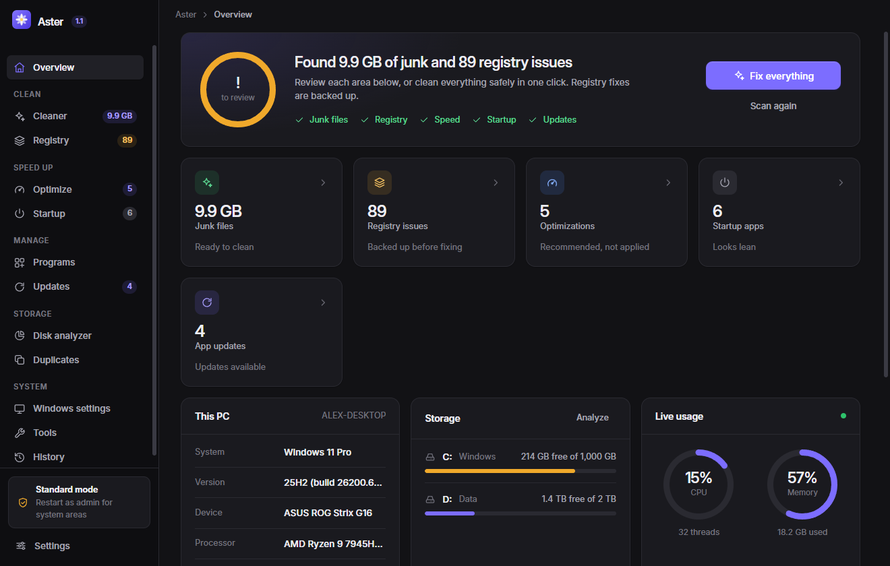
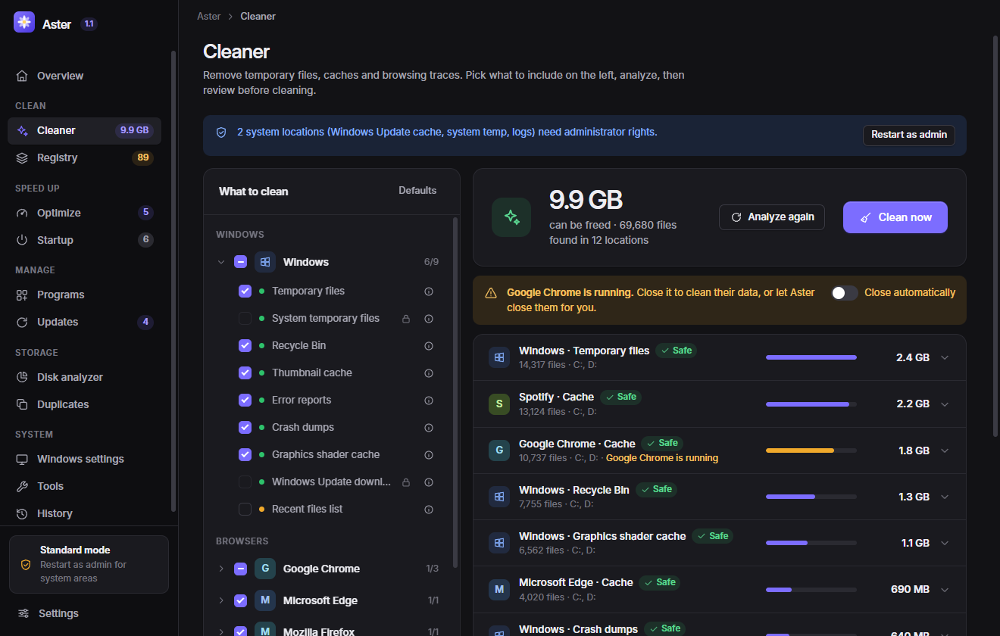
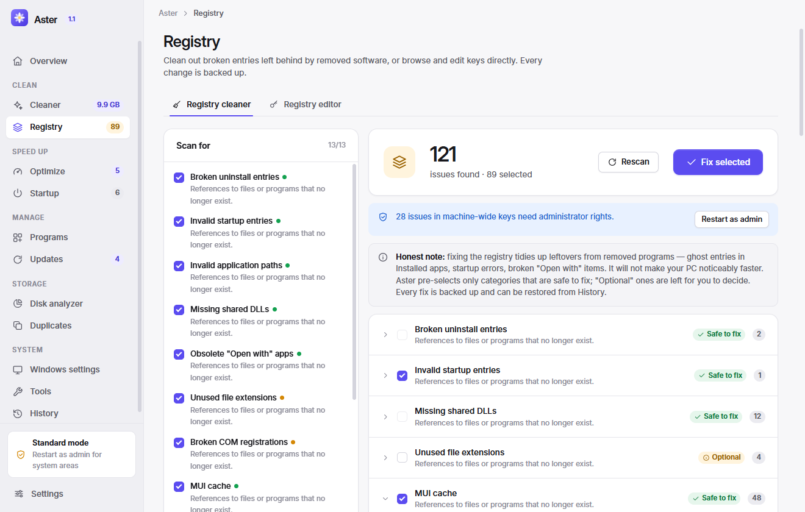
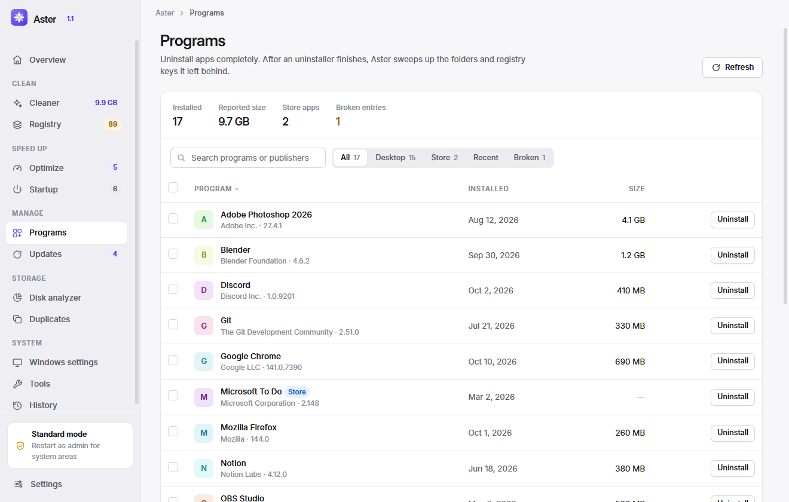
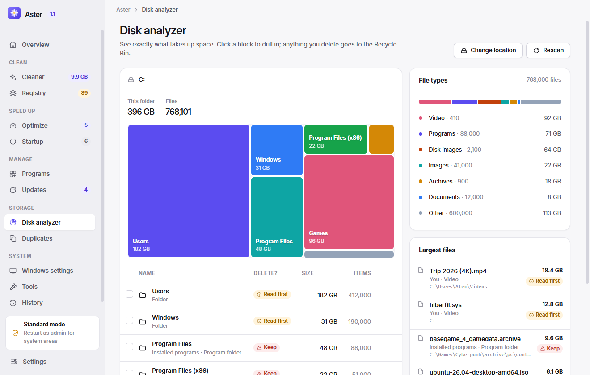

<p align="center">
  
</p>

<h1 align="center">Aster</h1>

<p align="center">
  <strong>A fast, honest cleaner, optimizer and uninstaller for Windows and macOS.</strong><br>
  Junk cleaning · Registry / leftovers cleaner · Complete uninstaller · Startup manager · Optimizer · App updates · Disk analyzer · Duplicate finder
</p>

<p align="center">
  
</p>

## Why Aster

Aster combines what you'd normally need CCleaner, Reg Organizer, Revo Uninstaller and WinDirStat for (or CleanMyMac, AppCleaner and DaisyDisk on a Mac) — in one clean, modern app with no ads, no telemetry, no upsells and no fake "health" scores. It is built natively for each platform: the Windows version works with the registry, services and WinGet; the Mac version works with your Library folder, launch agents, Homebrew and Time Machine.

- **Everything is explained.** Every cleaner item, registry category, large file and setting says in plain language what it is, what you lose and whether it's safe — before anything changes.
- **Everything is undoable where it matters.** Every registry change is exported to a `.reg` backup first and can be restored from History in one click. Your own files go to the Recycle Bin.
- **Nothing phones home.** Aster works entirely offline. The only network access is WinGet when you check for updates.

## Features

| | |
|---|---|
| **Smart Scan** | One click checks junk files, registry problems, startup apps and outdated software. "Fix everything" cleans junk and repairs the registry (with backup). |
| **Cleaner** | 40+ cleaning rules: Windows temp, Recycle Bin, thumbnail/shader/update caches, error reports, crash dumps, logs; Chrome, Edge, Brave, Opera, Vivaldi, Yandex and Firefox caches, history, cookies and sessions; Discord, Spotify, Teams, Slack, VS Code, Steam, npm, pip and more. Only installed apps are shown. Detects running apps and can close them for you. |
| **Registry cleaner** | 13 categories: broken uninstall entries, invalid startup entries, missing app paths and shared DLLs, obsolete "Open with" apps, unused file extensions, broken COM registrations, MUI cache, compatibility records, installer folders, fonts, help files and empty software keys. |
| **Registry editor** | Browse all hives, create/edit/rename/delete values of every type (`REG_SZ`, `EXPAND_SZ`, `MULTI_SZ`, `DWORD`, `QWORD`, `BINARY`), create and delete keys, search keys/values/data, import and export `.reg`. Protected Windows roots can't be deleted. |
| **Programs** | All desktop and Microsoft Store apps with real icons, sizes and dates. Runs the official uninstaller, then sweeps up leftover folders and registry keys. Batch uninstall, broken-entry cleanup and leftover scans for already-removed apps. |
| **Startup** | Registry Run keys, startup folders, scheduled tasks and third-party services. Enable/disable uses the same mechanism as Task Manager, so it's fully reversible. Flags entries pointing to missing files. Add your own programs. |
| **Optimize** | 16 reversible tweaks for speed, gaming and privacy, each with what you gain and what you give up; power plans explained; apps using the most memory. |
| **Windows settings** | Monitor refresh rate and resolution (auto-reverts if you don't confirm), screen and sleep timeouts, dark mode, Explorer and taskbar options. |
| **Updates** | Finds outdated software via Microsoft WinGet and updates one app or all of them silently. |
| **Disk analyzer** | Scans any drive or folder in a background thread. Interactive treemap, drill-down, file-type breakdown and the largest files. |
| **Duplicates** | Finds identical files by content (size → partial hash → full SHA-1), always keeps one copy, auto-selects all but the newest/oldest. |
| **Tools** | Create a restore point, flush DNS, empty the Recycle Bin, and quick access to 20+ Windows utilities. |
| **History** | Every change Aster makes, with one-click restore of registry backups. |

<p align="center">
  
  
  
  
</p>

## Windows and macOS

| | Windows | macOS |
|---|---|---|
| **Cleaner** | Temp, Windows Update, error reports, shader caches, 7 browsers, apps | ~/Library caches, logs, crash reports, Quick Look, Trash, iOS updates, Safari + 7 browsers, Xcode, Homebrew, apps |
| **Registry / Leftovers** | Registry cleaner (13 categories, .reg backups) + full registry editor | Leftovers of removed apps: preferences, caches, containers, saved state, broken launch agents (to the Trash) |
| **Programs** | Runs the real uninstaller, then removes leftover folders and registry keys | Quits the app, moves it to the Trash, removes its ~/Library data; shows when each app was last opened |
| **Startup** | Run keys, startup folders, scheduled tasks, services | Login items, launch agents, background daemons |
| **Updates** | WinGet | macOS updates, Homebrew formulae & casks, Mac App Store (via `mas`) |
| **Optimize** | 16 tweaks, power plans | Animations, Dock, Spotlight, Low Power Mode, .DS_Store, privacy |
| **Settings** | Refresh rate & resolution, Explorer, taskbar | Finder, Dock, keyboard & trackpad, screenshots, appearance |
| **Tools** | Restore point, DNS flush, Windows utilities | Time Machine snapshots, free purgeable space, Spotlight rebuild, DNS flush |

## Install

Download the latest release from the [Releases page](https://github.com/Nikita-Shulga/Aster/releases):

- **`Aster-Setup-x.y.z.exe`** — installer (per-user, no admin needed)
- **`Aster-x.y.z-portable.exe`** — portable, runs without installing

**Windows** 10 or 11 (x64). Builds are currently unsigned, so Windows SmartScreen may show a warning on first launch — choose **More info → Run anyway**.

**macOS** 12 Monterey or later — download `Aster-x.y.z-mac-arm64.dmg` for Apple Silicon (M1–M4) or `…-mac-x64.dmg` for Intel Macs, and drag Aster to Applications. The app is not notarized yet, so the first time:

1. Open Aster from Applications. macOS says it can't verify the developer — click **Done**.
2. Open **System Settings → Privacy & Security**, scroll down and click **Open Anyway** next to Aster.

If macOS reports the app is "damaged", run `xattr -cr /Applications/Aster.app` in Terminal once.

### Full Disk Access (macOS)

macOS protects Safari, Mail, the Trash and other apps' data even from you. To clean those, allow Aster in **System Settings → Privacy & Security → Full Disk Access** — Aster shows a button for this in the sidebar. Everything else works without it.

### Administrator mode (Windows)

Aster runs as a standard user by default. Some areas — the Windows Update cache, system temp and logs, machine-wide registry keys, services and restore points — need administrator rights. Click **Restart as administrator** in the sidebar when you need them.

## Safety model

| Action | What happens |
|---|---|
| Cleaning caches and temp files | Permanently deleted (they're regenerated automatically). Temp files newer than 24 h are skipped. Files in use are skipped. Folders you exclude in Settings are never touched. |
| Registry fixes and edits (Windows) | Exported to a `.reg` backup in `%APPDATA%\Aster\backups` *before* the change. Restore from History. |
| Leftovers, duplicates, disk analyzer deletions | Moved to the Recycle Bin / Trash. |
| macOS leftovers, apps, launch agents | Moved to the Trash. |
| Startup changes | Disabling uses Windows' `StartupApproved` flags (like Task Manager). Deleting a registry entry is backed up first; deleting a scheduled task saves its XML. |
| Uninstalling | Always runs the program's own uninstaller (or `Remove-AppxPackage` for Store apps). |

Aster never follows symbolic links or junctions while cleaning, refuses to clean shallow paths such as drive roots, and won't delete critical registry roots (`HKLM\SYSTEM`, `HKCU\Software`, `…\Microsoft`, etc.).

## Development

Aster is an Electron app with no runtime dependencies and no build step for the UI.

```bash
npm install
npm start            # run the app
npm test             # backend tests (uses disposable fixtures and a throwaway HKCU\Software\AsterSelfTest key)
npm run preview      # UI with sample data at http://127.0.0.1:4173 (no system access)
npm run dist         # Windows: installer + portable exe into dist/
npm run dist:mac     # macOS (run on a Mac): DMG + ZIP for Apple Silicon and Intel
```

```
src/
  main/        Electron main process — Windows implementation (registry, PowerShell, WinGet…)
    mac/       macOS implementation of the same API (defaults, launchctl, plists, Homebrew…)
    main.cjs   picks the platform layer, window, IPC routing and security policy
  renderer/    UI: index.html, styles.css (design system), js/pages/*
scripts/       preview server, icon renderer, screenshot capture, self-test
test/          node:test suites
```

Security: the renderer is sandboxed with context isolation, a strict CSP and no Node access. It talks to the main process through a single allow-listed `invoke` bridge. All PowerShell scripts are fixed in the source; renderer data reaches them only as JSON on stdin, never by string interpolation. On macOS, tools are run directly with argument arrays (no shell); the few actions that need administrator rights use the standard macOS password prompt.

Every push is built and tested on real Windows and macOS machines by GitHub Actions (see `.github/workflows/build.yml`); tags create a release with both platforms' installers.

## License

[MIT](LICENSE) © 2026 Nikita Shulga
