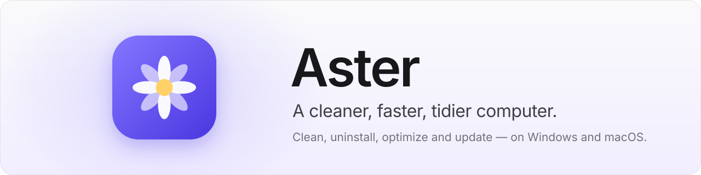
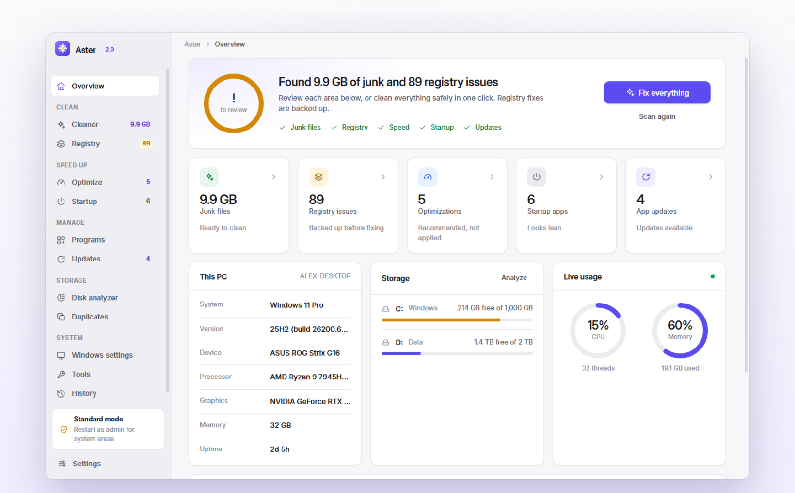
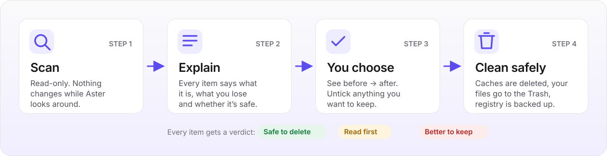
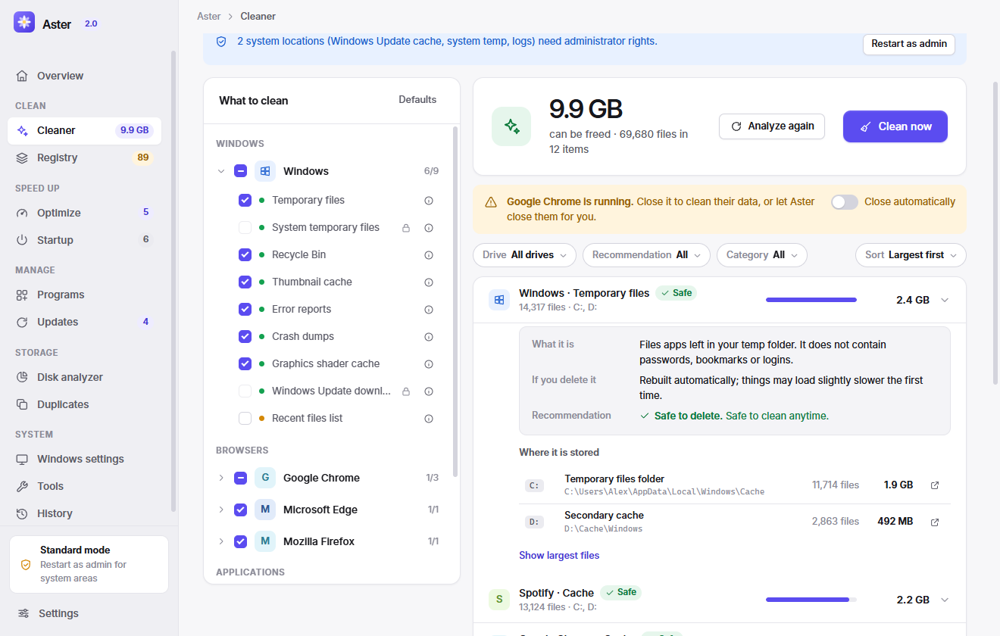
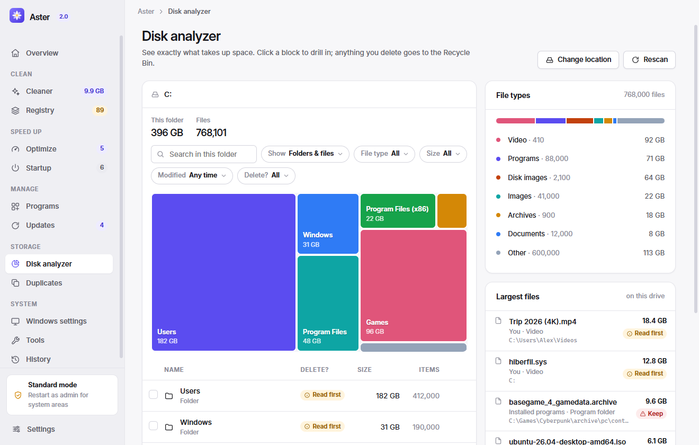
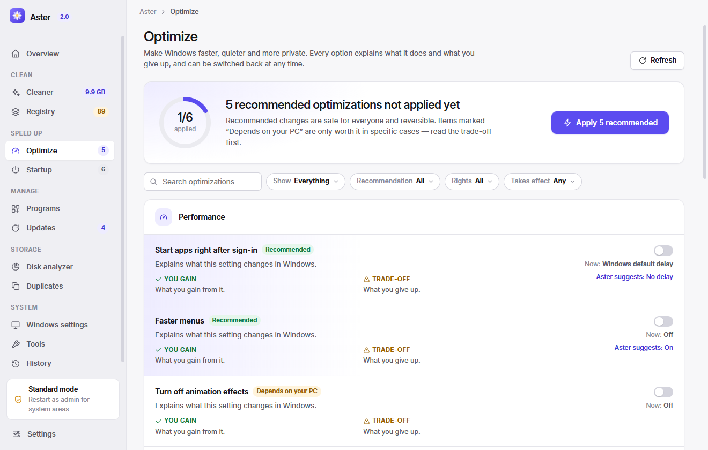

<p align="center">
  <picture>
    <source media="(prefers-color-scheme: dark)" srcset="docs/images/banner-dark.svg">
    
  </picture>
</p>

<p align="center">
  <a href="https://github.com/Nikita-Shulga/Aster/releases/latest"></a>
  <a href="https://github.com/Nikita-Shulga/Aster/actions/workflows/build.yml"></a>
  
  
  <a href="LICENSE"></a>
</p>

<p align="center">
  <b><a href="https://github.com/Nikita-Shulga/Aster/releases/latest">Download</a></b> ·
  <a href="#how-it-works">How it works</a> ·
  <a href="#screenshots">Screenshots</a> ·
  <a href="#faq">FAQ</a> ·
  <a href="docs/MAC.md">macOS notes</a> ·
  <a href="CHANGELOG.md">Changelog</a>
</p>

---

**Aster cleans, speeds up and declutters your Windows PC or Mac** — junk files, leftovers of removed apps, startup clutter, outdated software and forgotten gigabytes. It does what you'd normally need CCleaner, Reg Organizer, Revo Uninstaller and WinDirStat for (or CleanMyMac, AppCleaner and DaisyDisk on a Mac), in one calm app.

**Nothing changes until you've seen exactly what will happen.** Every item explains what it is, what you'd lose and whether it's safe to delete. No ads, no account, no telemetry, no scary “health scores”.

<p align="center">
  <picture>
    <source media="(prefers-color-scheme: dark)" srcset="docs/images/hero-dark.png">
    
  </picture>
</p>

## Features

|  |  |
| --- | --- |
| ⚡ **Smart Scan** | One click checks junk, registry or leftovers, optimizations, startup apps and updates. **Fix everything** cleans what is safe and tells you what else is worth a look. |
| 🧹 **Cleaner that explains itself** | System junk, 8 browsers and dozens of apps. Every item shows where it's stored on which drive, what it contains (“no passwords, bookmarks or logins”), what you'd notice afterwards, and a verdict: **Safe** · **Read first** · **Keep**. **Choose files** lists every file of an item to search, sort and pick from — send them to the Recycle Bin / Trash or delete them. **Automatic cleaning** runs daily or weekly without a window. |
| 🗂️ **Registry & leftovers** | Windows: a registry cleaner with 13 categories and automatic `.reg` backups, plus a full registry editor. macOS: settings, caches, containers and agents of apps you already deleted. |
| 📦 **Complete uninstaller** | Runs the real uninstaller (or moves the app to the Trash on a Mac), then sweeps up the folders, settings and registry keys it left behind. Batch uninstall, last-opened dates on Mac. |
| 🚀 **Startup & optimizer** | Startup apps, tasks, services, login items and launch agents — switched the same way the OS does it. Reversible tweaks with their trade-offs, power plans, apps hogging memory. |
| 🔄 **Updates** | WinGet on Windows; macOS, Homebrew and App Store updates on a Mac — one app or all at once. |
| 🧭 **Disk analyzer, duplicates & empty folders** | Treemap of any drive, file types, the largest files — and for each one, *what it is, which program owns it and whether deleting it breaks anything*. Content-based duplicate finder across drives. **Empty folders** finds folders with nothing in them (never system or app folders). |
| 🩺 **Drive health & repair** | S.M.A.R.T. status of every drive on Overview (wear, temperature and hours when available). Windows: System File Checker, DISM and a drive error scan with live progress and a plain verdict. macOS: First Aid check of the startup disk. |
| 🔎 **Fix search** | Windows Search or Spotlight can't find an app you have? Aster checks the search service and its index, finds programs search can't see (on Windows: apps with no Start menu shortcut, e.g. on a second drive) and adds them back. Restart or rebuild search in one click. |
| 🔍 **Filters everywhere** | Drive, size, date, type, publisher, verdict, last opened… Every list can be narrowed down, and every option shows how many items it matches. |
| ↩️ **Undo-friendly** | Your files go to the Recycle Bin / Trash, registry changes are backed up first, and **History** restores any backup in one click. |
| 🌗 **Feels native** | Light and dark themes, English or Russian interface (**Settings → Language**), native title bar and window controls, Full Disk Access guidance on Mac, works without admin rights. |

## Download

<p align="center">
  <a href="https://github.com/Nikita-Shulga/Aster/releases/latest/download/Aster-Windows-Setup.exe"></a>
  <a href="https://github.com/Nikita-Shulga/Aster/releases/latest/download/Aster-Mac-AppleSilicon.dmg"></a>
  <a href="https://github.com/Nikita-Shulga/Aster/releases/latest/download/Aster-Mac-Intel.dmg"></a>
</p>

| System | Package | Notes |
| --- | --- | --- |
| **Windows 10 / 11** | `Aster-Setup-<version>.exe` | Installer, per-user, no admin needed |
| Windows 10 / 11 | `Aster-<version>-portable.exe` | Runs without installing |
| **macOS 12+**, Apple silicon | `Aster-<version>-mac-arm64.dmg` | M1 – M4 |
| macOS 12+, Intel | `Aster-<version>-mac-x64.dmg` | |

Get them from the **[latest release](https://github.com/Nikita-Shulga/Aster/releases/latest)**. Each release also has `SHA256SUMS.txt` for verifying the downloads.

**Windows:** run the installer (or the portable exe). The app isn't code-signed yet, so SmartScreen may warn you the first time: click **More info → Run anyway**.

**macOS:** open the DMG and drag **Aster** to **Applications**. The Mac build is ad hoc signed, not notarized, so the first launch needs **System Settings → Privacy & Security → Open Anyway**. To clean Safari, Mail and the Trash, allow **Full Disk Access** — Aster shows a button for it. Details in [docs/MAC.md](docs/MAC.md).

## Quick start

1. **Open Aster** and press **Run Smart Scan** on the Overview.
2. **Look at the results.** Click any card — Junk files, Registry/Leftovers, Optimizations, Startup, Updates — to see the details and the reasoning behind each item.
3. **Press Fix everything**, or clean area by area. Only safe items are pre-selected; anything you'd notice is listed separately before you confirm.

> [!TIP]
> Some areas — the Windows Update cache, machine-wide registry keys, services — need administrator rights on Windows: use **Restart as administrator** in the sidebar. On a Mac, the equivalent is **Full Disk Access**.

## How it works

<p align="center">
  <picture>
    <source media="(prefers-color-scheme: dark)" srcset="docs/images/how-it-works-dark.svg">
    
  </picture>
</p>

| What Aster changes | What actually happens | Can you undo it? |
| --- | --- | --- |
| **Caches and temporary files** | Deleted. Temp files newer than 24 h, files in use and folders you exclude are skipped. Links are never followed. | Not needed — they rebuild automatically |
| **Your files** (disk analyzer, duplicates, leftovers) | Moved to the Recycle Bin / Trash | ✅ Put them back from the Recycle Bin / Trash |
| **Registry** (Windows) | Exported to a `.reg` backup, then changed | ✅ **History → Restore** |
| **Startup items** | Switched with the same flags Task Manager / System Settings use; deletions are backed up | ✅ Switch back, or restore from History |
| **Settings & optimizations** | One setting at a time, with a before → after preview | ✅ Switch back on the same page |
| **Uninstalling** | The program's own uninstaller (Windows) or Trash (Mac), then a leftover review | Reinstall the app |

The Windows and Mac versions share one interface but are built natively: the Windows side works with the registry, PowerShell, WinGet and Explorer; the Mac side with `~/Library`, `launchctl`, `defaults`, Homebrew and Time Machine. Protected Windows registry roots can't be deleted, and Aster never touches Apple's own files.

## Screenshots

<table>
  <tr>
    <td width="50%"><picture><source media="(prefers-color-scheme: dark)" srcset="docs/images/cleaner-dark.png"></picture><p align="center"><b>Cleaner</b> — every item explained</p></td>
    <td width="50%"><picture><source media="(prefers-color-scheme: dark)" srcset="docs/images/disk-dark.png"></picture><p align="center"><b>Disk analyzer</b> — what is it, and can I delete it?</p></td>
  </tr>
  <tr>
    <td width="50%"><picture><source media="(prefers-color-scheme: dark)" srcset="docs/images/programs-dark.png"></picture><p align="center"><b>Programs</b> — uninstall completely</p></td>
    <td width="50%"><picture><source media="(prefers-color-scheme: dark)" srcset="docs/images/optimize-dark.png"></picture><p align="center"><b>Optimize</b> — reversible, with trade-offs</p></td>
  </tr>
</table>

<sub>All screenshots use Aster's built-in sample data.</sub>

## FAQ

<details>
<summary><b>Will cleaning make my computer faster?</b></summary>

Sometimes a little — mostly it frees disk space, which matters a lot when a drive is nearly full. Aster is honest about it: clearing caches doesn't speed anything up by itself, and registry cleaning is housekeeping, not a performance boost. The real speed wins are on the **Startup** and **Optimize** pages, and Aster says so.
</details>

<details>
<summary><b>Can I break something?</b></summary>

Aster is built to make that hard. Only items marked **Safe** are pre-selected. Anything you would notice — signing out of websites, losing open tabs, emptying the Recycle Bin — is listed separately before you confirm. Your own files go to the Recycle Bin / Trash, registry changes are backed up and restorable from **History**, and protected Windows keys and Apple's files are off-limits.
</details>

<details>
<summary><b>Does it delete my passwords, bookmarks or logins?</b></summary>

No. Browser cache cleaning never touches passwords, bookmarks or history. Cookies (which keep you signed in) and history are separate items, are **not** selected by default, and are marked so you know what they do.
</details>

<details>
<summary><b>Why does it need administrator rights / Full Disk Access?</b></summary>

It doesn't for most things. On Windows, a few system areas (Windows Update cache, system temp, machine-wide registry keys, services, restore points) need admin rights — use **Restart as administrator** when you want them. On macOS, Apple protects Safari, Mail and the Trash even from you, so cleaning those needs **Full Disk Access**. Everything else works without it.
</details>

<details>
<summary><b>Does Aster send anything over the internet?</b></summary>

No telemetry, no account, no analytics. The only network activity is when you press **Check for updates**: on the Updates page that asks WinGet (Windows) or Homebrew / Apple (Mac) about your apps; in **Settings → Updates** it asks GitHub for the latest Aster release.
</details>

<details>
<summary><b>How do I update Aster?</b></summary>

Open **Settings → Updates** and press **Check for updates**. If there's a new version, **Update now** downloads it from this repository's releases, checks it against the published `SHA256SUMS.txt`, installs it and reopens Aster. The portable app opens the new portable file; on a Mac the new DMG opens in Finder, ready to drag into Applications. (Versions before 2.2.0 need one manual install.)
</details>

<details>
<summary><b>Why does Windows or macOS warn about an unknown developer?</b></summary>

The builds aren't code-signed or notarized yet. You can check each download against `SHA256SUMS.txt` in the release, or [build it yourself](#build-from-source).
</details>

## Build from source

You need [Node.js](https://nodejs.org) 22 or newer. There are no runtime dependencies — the UI is plain JavaScript and CSS.

```sh
git clone https://github.com/Nikita-Shulga/Aster.git
cd Aster
npm install
npm start              # run the app
npm test               # tests for your platform (fixtures and throwaway keys only)
npm run preview        # the UI with sample data at http://127.0.0.1:4173 (?platform=darwin for the Mac UI)
npm run dist           # Windows: installer + portable exe in dist/
npm run dist:mac       # macOS (on a Mac): DMG + ZIP for Apple silicon and Intel
```

### Project layout

```
src/main/        Electron main process — Windows implementation (registry, PowerShell, WinGet…)
src/main/mac/    macOS implementation of the same API (defaults, launchctl, plists, Homebrew…)
src/renderer/    sandboxed UI: design system (styles.css), pages, filters, sample data
scripts/         preview server, icon and README artwork generators, self-test
test/            node:test suites for Windows and macOS
docs/            macOS notes, images
```

### Releasing

Bump the version in `package.json`, add a section to `CHANGELOG.md`, then push a tag such as `v2.1.0`. GitHub Actions tests and builds both platforms on real Windows and macOS machines — including a self-test that drives the real app through every page — and attaches all downloads to a draft release.

## Contributing

Bug reports, ideas and pull requests are welcome. Start with **[CONTRIBUTING.md](CONTRIBUTING.md)** — it explains how the pieces fit together and the rule every change must keep: *explain before you change anything, and keep it undoable.*

- 🐞 [Report a bug](https://github.com/Nikita-Shulga/Aster/issues/new?template=bug_report.yml)
- 💡 [Suggest a feature](https://github.com/Nikita-Shulga/Aster/issues/new?template=feature_request.yml)
- 🔐 [Report a vulnerability privately](https://github.com/Nikita-Shulga/Aster/security/advisories/new)

Please follow the [Code of Conduct](CODE_OF_CONDUCT.md). For questions, see [SUPPORT.md](SUPPORT.md).

## License

[MIT](LICENSE) © 2026 [Nikita Shulga](https://nikitashulga.com)

Electron keeps its own license, shipped inside every release. The Inter typeface is used under the SIL Open Font License.

<sub>Aster is an independent project, not affiliated with or endorsed by Microsoft, Apple, Piriform (CCleaner), ChemTable (Reg Organizer) or any other company mentioned. Windows is a trademark of Microsoft; macOS and Safari are trademarks of Apple.</sub>
